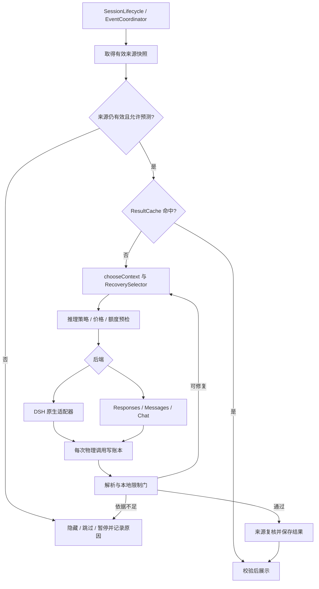

# 架构与取舍

[English](en/architecture.md) · [README](../README.md)

## 两种缓存

结果缓存保存已经完成的建议，按线程、来源修订、轮次、后端与有效配置区分。命中后不调用模型。思考策略新增默认字段时，不把默认值塞进旧结果键，避免升级无故重算。

服务端缓存复用的是请求前缀。保持系统配置、工具和历史的稳定次序，在后部追加预测指令。服务商决定缓存是否保留，只有 usage 能确认命中；本地推算不等于已命中。

## 请求路径

预测是插件内的独立作业，不把草稿写成真实 user 消息，也不创建供用户浏览的预测聊天。显示、接受与请求结束都检查来源，迟到的旧结果直接丢弃。模型调用属于你配置的服务商；这里不是 Codex 的私有服务端 fork。

代码入口：[index](../plugin/src/index.mjs)、[engine](../plugin/src/core/engine.mjs)、[lifecycle](../plugin/src/core/lifecycle.mjs)。

## 上下文选择

主线程先生成自己的有效上下文，插件读取这个快照。父线程已经概括或压缩时，使用压缩后的有效内容，不从旧记录拼回完整原文。

原生采样路径优先保留父上下文；便携路径可比较 full、prefix-tail、local-window、frozen-window。选择考虑长度、可复用前缀、已观察的缓存比例、价表和质量余量。工具调用与结果按完整单元保留。

冻结窗口减少窗口边界每轮移动带来的前缀变化。本版本不额外发起一个 LLM 摘要作业来压缩历史；已有主线程摘要可以作为有效历史的一部分。没有已验证的摘要收益时，不把省下的输入 token 直接当作省钱。

外部编辑、工具结构改变或父线程压缩会触发映射复核。预计保留的可复用前缀低于 50% 时暂停该线程，而不是不断请求重建缓存。

代码：[context-mapping](../plugin/src/core/context-mapping.mjs)、[context-events](../plugin/src/core/context-events.mjs)、[loop-watchdog](../plugin/src/core/loop-watchdog.mjs)。

## 修复选择器

在草稿修复、父上下文重生成、父上下文附带草稿之间估算总费用。优先使用同请求近期 usage；缓存证据会打折并随证据年龄衰减。包含输出成本，未知思考开销按保守上限处理。

这是有边界的启发式选择器，不能证明每次全局最优。没有可用的确切价格时不自动发请求。修复后仍要过同样的本地检查。

代码：[recovery-selector](../plugin/src/core/recovery-selector.mjs)、[recovery](../plugin/src/core/recovery.mjs)。

## 协议与思考

默认能关闭思考就关闭，否则取模型最低合法档。原生 DSH 使用适配器公布的模型能力。便携协议使用已知型号规则或用户声明的 reasoningControl；未知型号不通过收费请求猜参数。

用户可保存 reasoningMode=configured，按父请求或所选后端配置执行；更高思考档位由用户主动决定。修复沿用同一策略。设置变化不会自动重复当前轮的付费调用。

Responses、Anthropic Messages、Chat Completions 的字段、缓存信息和 usage 口径不同，分别转换；不默默更换协议。无法保持的历史在严格模式拒绝，显式 portable-text 迁移会标记降级。

代码：[transports](../plugin/src/core/transports.mjs)、[reasoning-policy](../plugin/src/core/reasoning-policy.mjs)、[profiles](../plugin/src/core/profiles.mjs)。

## 费用账本

每次真实调用分开记录，重试和修复不会被并成一次。先写 pending，完成后结算。用量未结算时停止继续自动消费，不能靠重试覆盖这笔未知费用。

DeepSeek / Messages 的缓存与冷输入是分量；Responses / Chat 的 input 总量通常已包含缓存读取。统一归一化后计费，不能再把缓存 token 或思考 token 加一次。

价格版本和请求开始时间一起保存，峰谷计算按价表时区。不同币种分别算占比；没有暗中换汇。主会话账本与预测账本分开，再按同线程与覆盖范围汇总。

代码：[billing](../plugin/src/core/billing.mjs)、[thread-accounting](../plugin/src/core/thread-accounting.mjs)。

## 显示与接受

建议只覆盖空输入框的占位区域，不自动发送。输入、附件、IME、菜单、排队消息和运行状态都有资格检查。Tab 接受前重新检查线程、轮次、来源修订和草稿版本；检查不通过不插入。

中文与英文通过 DSH 的 locale 服务切换。设置使用宿主控件与独立设置分区，费用位于线程的横向页签。

代码：[client](../plugin/src/client)、[边界表](boundaries.zh-CN.md)。
