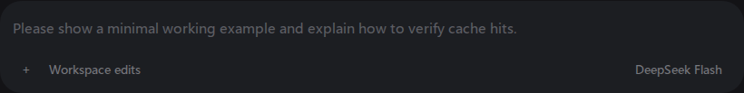
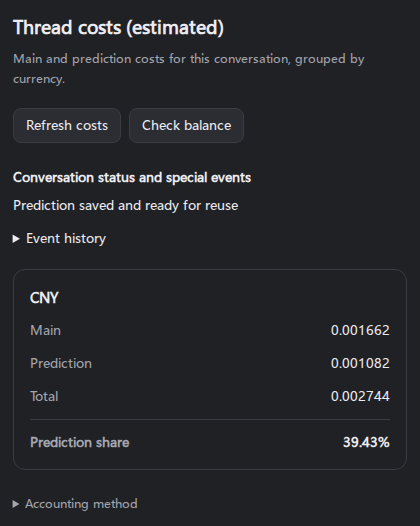
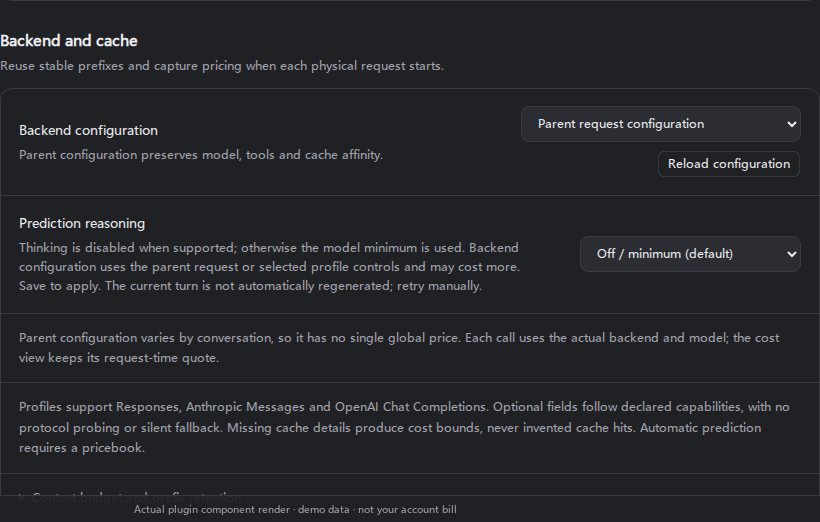
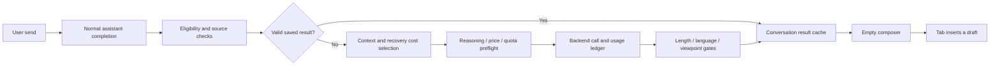

# DSH Composer Prediction


Current release: **0.8.0-beta.4** (beta).

[简体中文](README.md) · [Features](docs/en/features.md) · [Architecture](docs/en/architecture.md) · [Boundaries](docs/en/boundaries.md)

An unofficial next-message prediction plugin for DeepSeek Harness. After a normal assistant completion, a suggestion appears in the empty composer. **Tab** inserts an editable draft. You decide whether to send it.

Prioritizes context-cache reuse and records each prediction request's cost. Supports DeepSeek, OpenAI Responses, Anthropic Messages and Chat Completions.



*Captured from actual plugin components with demo conversation data, not a user's chat.*

## Install

Requires [DeepSeek Harness](https://github.com/deepseek-ai/deepseek-harness). This is a beta; see [package.json](package.json) for host compatibility.

In DSH, open **Plugins → Add plugin** and enter:

```text
@jhckevin/dsh-composer-prediction
```

Or install from npm through DSH:

```sh
dsh plugin --profile desktop add @jhckevin/dsh-composer-prediction@latest --ignore-scripts --registry=https://registry.npmjs.org/
```

On Windows, if dsh is not on PATH:

```powershell
& "$env:LOCALAPPDATA\Programs\DeepSeek Harness\resources\runtime\cli\bin\dsh.cmd" plugin --profile desktop add @jhckevin/dsh-composer-prediction@latest --ignore-scripts --registry=https://registry.npmjs.org/
```

[Releases](https://github.com/jhckevin/dsh-composer-prediction/releases) also provides a **Windows installer ZIP**. Extract it and run install.cmd. It uses DSH's bundled CLI and does not install global Node/npm. See [Windows instructions](docs/en/windows.md) for offline installation and checksums.

Registry installations use DSH's native version checks. Users choose when to install an update. Offline file installations do not have the same registry update source.

## Features and usage

- One prediction per eligible source after normal assistant completion. Errors, cancellation and interrupted replies do not trigger one.
- Display and acceptance check the conversation, source revision and draft state. Starting a send or changing the source clears stale suggestions.
- Saved results belong to their conversation. Switching views does not purchase another prediction.
- New conversations are enabled by default. Workspaces and individual conversations can be blocked.
- Catch-up defaults to the latest three conversations with a user send within 24 hours. Saved predictions do not expire after that window.

Open **Settings → Composer predictions**. Reasoning defaults to **off / minimum**. Explicitly choose **Use backend configuration** and save to change it. Repairs follow the selected policy. Changing settings does not automatically regenerate the current turn.

Use instruction_prediction.md for additional constraints. Local reliability rules take precedence.

[Full feature guide](docs/en/features.md): triggers, conversation eligibility, both caches, backend selection, defaults and updates.

## Cache and accounting

Keep reusable prefixes stable and append prediction instructions near the end. Parent compaction is inherited. The context selector compares full context, prefix-plus-tail and frozen windows; recovery compares repair costs using known usage and prices. These are local estimates, not a global optimum.

Changing reasoning, models, tools, summaries or early history can reduce cache hits. A short cold input can cost more than a long cached one. Provider usage is authoritative; no fixed hit rate is promised.



*Actual responsive component test with demo amounts.*

**Prediction share = Prediction / (main conversation + Prediction).**

Accounting is per conversation, currency and coverage period. It includes retries and repairs, captures the price at request start, and applies schedules declared by the pricebook. Unknown prices or usage never become zero. Missing cache details remain unknown; full coverage, historical gaps and estimate ranges are reported separately.

## Failure handling

| Condition | Behavior and recovery |
| --- | --- |
| Unfinished assistant reply or an existing draft | Wait for normal completion and eligible input; never overwrite |
| Insufficient evidence | Return `suggestion:false`; show nothing for this turn |
| Length, language or viewpoint failure | At most one automatic repair; optional truncation still passes other gates |
| Transient network error | At most 3 additional retries shared across the task; configurable |
| Dispatched request with incomplete usage | Stop automatic spending; retain unresolved accounting |
| Explicit quota rejection | Pause passive prediction and arm recovery checks; manual retry remains allowed at the quota layer |
| Unsupported balance API or cache detail | Keep unknown; no guessed endpoints or paid probes |
| External history edit | Remove stale output and remap; pause below 50% estimated reusable-prefix retention |
| Missing price or historical accounting | Block unpriced new predictions before dispatch; do not replace historical gaps with zero |

Events run oldest to newest, retaining the latest 32. Context updates, snapshot checks and queue entries are not additional model calls. Use ledger physical attempts to investigate repeated spending.

See [Failures, logs and recovery](docs/en/boundaries.md) for retry limits, balance recovery, context limits, third-party compatibility and why amounts can exist without a complete share.

## Settings



*Current components with demo configuration. Off / minimum is the default; changes require Save.*

## Design



Lifecycle validation follows logical events rather than second-based polling. Local result caching is separate from provider prefix caching. Tool histories retain call/result pairing. Each physical request has its own billing entry; reasoning tokens are not charged twice. Unresolved usage stops further automatic spending.

Native DSH adapters and portable protocols are separate paths. Third-party capabilities must be declared when unknown. There are no paid capability probes or silent protocol fallbacks. This does not claim parity with Codex's private server controls.

See [Architecture](docs/en/architecture.md), [Boundaries](docs/en/boundaries.md) and [Protocol profiles](PROTOCOL-COMPAT.zh-CN.md).

## Data

Settings, blocklists, results and accounting live in ~/.dsh/plugins-data/composer-prediction. Selected context is sent to your configured model provider. The data directory, credential references and chat snapshots are excluded from this repository. Do not attach them to public issues.

## Develop

Node.js 24.9+; run from the repository root:

```sh
npm ci
npm run setup
npm run build
npm test
npm run verify
```

Setup fetches a pinned DSH commit and verifies its SHA-256. Tests mock network/model calls: no API key or paid generation is required. CI checks builds, regression tests and the Windows installer. See [CONTRIBUTING](https://github.com/jhckevin/dsh-composer-prediction/blob/main/CONTRIBUTING.md).

## License

[MIT](LICENSE). Upstream code and licenses are listed in [Third-party notices](THIRD_PARTY_NOTICES.md). No proprietary Codex client code or authenticated remote prompt is included.
