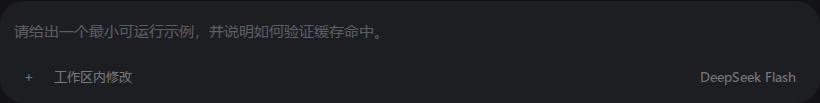
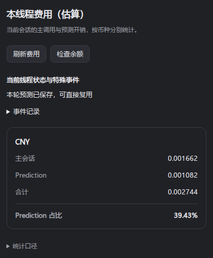
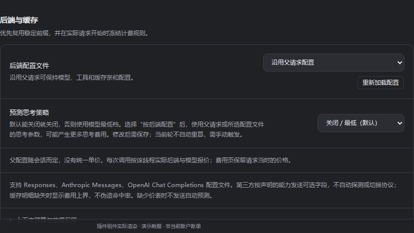
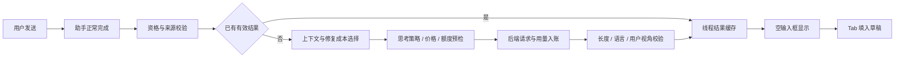

# DSH Composer Prediction


当前版本：**0.8.0-beta.4**（beta）。

[English](README.en.md) · [安装](#安装) · [架构](docs/architecture.zh-CN.md) · [边界与费用](docs/boundaries.zh-CN.md)

DeepSeek Harness 的非官方下一条消息预测插件。助手正常回复结束后，在空输入框里显示建议；按 **Tab** 填入可编辑草稿，发送仍由你决定。

优先复用上下文缓存，逐次记录预测费用。支持 DeepSeek、OpenAI Responses、Anthropic Messages 和 Chat Completions。



*真实插件组件的测试截图，使用演示对话；不是用户聊天记录。*

## 安装

需要已安装的 [DeepSeek Harness](https://github.com/deepseek-ai/deepseek-harness)。当前是 beta，支持的 DSH 范围见 [package.json](package.json)。

**在 DSH 内安装：** 插件 → 添加插件，输入：

```text
@jhckevin/dsh-composer-prediction
```

**从 npm 安装：**

```sh
dsh plugin --profile desktop add @jhckevin/dsh-composer-prediction@latest --ignore-scripts --registry=https://registry.npmjs.org/
```

Windows 没有 `dsh` 命令时，使用 DSH 自带 CLI：

```powershell
& "$env:LOCALAPPDATA\Programs\DeepSeek Harness\resources\runtime\cli\bin\dsh.cmd" plugin --profile desktop add @jhckevin/dsh-composer-prediction@latest --ignore-scripts --registry=https://registry.npmjs.org/
```

也可从 [Releases](https://github.com/jhckevin/dsh-composer-prediction/releases) 下载 **Windows 安装包 ZIP**，解压后运行 `install.cmd`。它调用 DSH 自带 CLI，不安装全局 Node/npm。详细步骤、离线安装和校验见 [Windows 安装](docs/windows.zh-CN.md)。

从 npm 来源安装后，在插件详情页的“版本”中检查更新。是否下载安装由用户决定；本插件不另设后台更新器。离线文件来源不具备同样的 registry 更新入口。

## 使用

- 助手正常完成后，每个有效来源生成一次。错误、中断、取消不触发预测。
- 建议只在适合输入时显示。切换线程、开始发送、来源变化时撤下旧建议；接受前再校验一次。
- 已有预测按线程保存。切换界面不重新请求；历史改变后不能继续接受旧建议。
- 新线程默认开启；工作区和特定线程可以加入黑名单。
- 旧线程补生成默认限最后用户发送在 24 小时内、最新最多 3 个。这不是已保存预测的过期时间。

设置位于 **设置 → 下一条消息预测**。思考默认是“关闭／最低”，可以主动改为“按后端配置”并保存。修复请求沿用同一策略，切换策略不会自动重做当前轮。

额外约束写入 `instruction_prediction.md`；本地安全与可靠性限制优先。

## 缓存和费用

保持稳定前缀，预测指令放在后部。沿用父线程已有的有效压缩上下文；可选完整上下文、前缀加近期窗口、冻结窗口等方案。恢复选择器按已知用量和价格估算修复成本，不保证全局最优。

思考档位、模型、工具、摘要或前部历史改变，都可能损失缓存。短输入也可能比长而高命中的输入更贵。以服务商返回的 usage 为准，不承诺固定命中率。



*真实组件的响应式测试截图，费用为演示数据。*

**Prediction 占比 = Prediction /（主会话 + Prediction）**

按线程、币种和统计覆盖范围计算，包含自动重试、手动重试和修复。每次请求保留开始时的价格快照；支持价表声明的峰谷时段。缺失价格或 usage 不记作零，缺少缓存明细也不伪造命中率。完整统计、历史缺口和估算范围分别展示。

## 设置



*本版本组件实测，使用演示配置。默认关闭／最低思考，修改后需保存。*

## 实现



- **生命周期：** 用户发送和正常完成驱动，不按秒轮询对话。来源修订号、轮次和草稿状态共同保护显示与接受。
- **缓存：** 本地结果缓存与服务端前缀缓存分开。命中旧结果不调用模型；服务端命中仍由 usage 确认。
- **上下文：** 工具调用与结果完整配对；使用父线程有效快照。窗口选择是本地增强，不宣称复刻 Codex 私有服务端。
- **后端：** 原生 DSH 适配器和便携协议分开。未知第三方能力要声明，不收费探测、不静默换协议。
- **计费：** 每次物理请求独立入账，推理 token 不重复计费。请求用量未结算时阻止继续自动消费。

细节见 [架构与关键取舍](docs/architecture.zh-CN.md)、[边界处理](docs/boundaries.zh-CN.md)、[协议配置](PROTOCOL-COMPAT.zh-CN.md)。

## 数据

配置、黑名单、结果和账本保存在 `~/.dsh/plugins-data/composer-prediction`。预测会把选定上下文发送给你配置的模型服务商。该目录及其中的密钥引用、聊天快照和账本不属于开源仓库，也不应上传到 issue。

## 开发

Node.js 24.9+，以下命令在仓库根目录运行：

```sh
npm ci
npm run setup
npm run build
npm test
npm run verify
```

setup 下载固定 commit 的 DSH 公共源码，并校验 SHA-256。依赖和锁文件随仓库提供。测试使用模拟网络，不需要 API Key，不产生模型费用。CI 覆盖构建、回归和 Windows 安装脚本检查；开发流程见 [CONTRIBUTING](https://github.com/jhckevin/dsh-composer-prediction/blob/main/CONTRIBUTING.md)。

## 许可证

[MIT](LICENSE)。包含 DeepSeek Harness 的公共适配器、Schema 和 tokenizer 相关代码；上游版权与许可证见 [第三方说明](THIRD_PARTY_NOTICES.md)。不包含 Codex 私有客户端代码或认证后才能取得的提示词。
